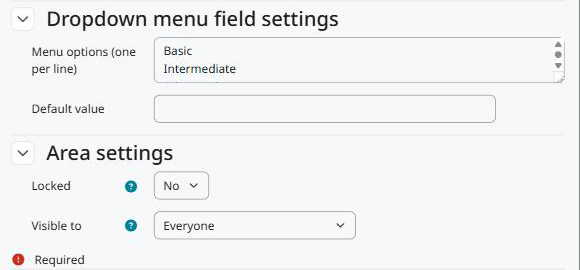

Configuration
=============

Go to *Site administration > Competencies*. There are two pages, one per area:

* *Competency custom fields*: fields of every competency.
* *Competency framework custom fields*: fields of every competency framework.

Each page works like the course custom fields page: add a category to group the fields, then add the fields and choose their type.

   The area settings at the end of the field form.

Area settings
-------------

Locked
   Only users with ``tool/competencycustomfields:changelockedcustomfields`` can edit the value.

Visible to
   * *Everyone*: everyone who can see the competency or framework, on its pages and through the web service.
   * *Users who can edit the values*: only users with ``tool/competencycustomfields:edit`` in the context of the framework.
   * *Nobody*: the value is not shown and not returned by the web service. Users who can edit the values still see it on the editing page.

Capabilities
------------

``tool/competencycustomfields:configurecustomfields`` (system)
   Manage the fields of both areas. Manager by default.

``tool/competencycustomfields:edit`` (category)
   Edit the values of the competencies and frameworks in that context. Manager by default, and copied from ``moodle/competency:competencymanage`` on install.

``tool/competencycustomfields:changelockedcustomfields`` (category)
   Edit locked fields. Manager by default.
