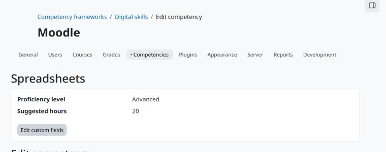

moodle-tool_competencycustomfields
==================================

**Custom fields for competencies and competency frameworks: manage them like course custom fields, edit the values from the competency pages and read them in integrations.**

   The values of a competency, with the link to edit them.

* **Fields where Moodle has none.** Moodle has custom fields for courses, cohorts and groups, but not for competencies. This tool adds two areas: competencies and competency frameworks.
* **Every field type.** Text, text area, menu, checkbox, date and any other custom field type installed on the site, with the usual settings.
* **Control who sees each value.** Every field is visible to everyone, only to those who can edit the values, or to nobody.
* **Ready for integrations.** The ``local_fieldssuite_get_values`` web service returns the values the user can see.

Part of the `Moodle Fields Suite <https://moodle-fields-suite.github.io>`_; requires `local_fieldssuite <https://moodle-fields-suite.github.io/local_fieldssuite/>`_.

Versão em português: `Português (Brasil) <../pt-br/index.html>`_.

.. toctree::
   :maxdepth: 2
   :caption: Contents

   installation
   configuration
   usage

Links
-----

* Source code and issues: https://github.com/moodle-fields-suite/tool_competencycustomfields
