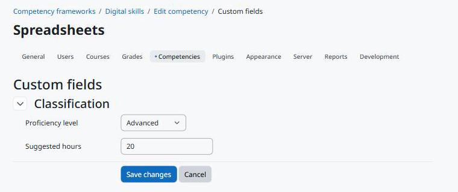

Usage
=====

Editing the values
------------------

The values and an *Edit custom fields* button appear at the top of these pages, for users who can edit the values:

* the page that edits a competency (*Edit* in the competency menu of a framework): values of the competency;
* the page that edits a framework and the framework page with its competency tree: values of the framework.

The button opens the common editing page of the Moodle Fields Suite. Save to go back to the framework.

   Editing the values of a competency.

Users who cannot edit see only the values visible to them; when there are none, nothing is shown.

Web service
-----------

``local_fieldssuite_get_values`` with ``component=tool_competencycustomfields``, ``area=competency`` (or ``framework``) and the ``instanceids`` returns, for each competency or framework the user can see, the fields the user can see.

.. code-block:: bash

   curl "https://moodle.example/webservice/rest/server.php?wstoken=TOKEN&moodlewsrestformat=json&wsfunction=local_fieldssuite_get_values&component=tool_competencycustomfields&area=competency&instanceids[0]=12"

Deleting
--------

Deleting a competency deletes its values; deleting a framework deletes its values and those of its competencies. The fields stay.
