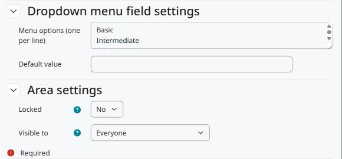

Configuração
============

Acesse *Administração do site > Competências*. Há duas páginas, uma por área:

* *Competency custom fields*: campos de todas as competências.
* *Competency framework custom fields*: campos de todos os quadros de competências.

Cada página funciona como a dos campos personalizados do curso: crie uma categoria para agrupar os campos, depois os campos e o tipo de cada um.

   As configurações da área no fim do formulário do campo.

Configurações da área
---------------------

Bloqueado
   Só usuários com ``tool/competencycustomfields:changelockedcustomfields`` podem editar o valor.

Visível para
   * *Todos*: todos que podem ver a competência ou o quadro, nas páginas deles e pelo web service.
   * *Usuários que podem editar os valores*: só usuários com ``tool/competencycustomfields:edit`` no contexto do quadro.
   * *Ninguém*: o valor não aparece nem é devolvido pelo web service. Quem pode editar os valores continua vendo-o na página de edição.

Permissões
----------

``tool/competencycustomfields:configurecustomfields`` (sistema)
   Gerenciar os campos das duas áreas. Gerente, por padrão.

``tool/competencycustomfields:edit`` (categoria)
   Editar os valores das competências e dos quadros naquele contexto. Gerente, por padrão, e copiada de ``moodle/competency:competencymanage`` na instalação.

``tool/competencycustomfields:changelockedcustomfields`` (categoria)
   Editar campos bloqueados. Gerente, por padrão.
