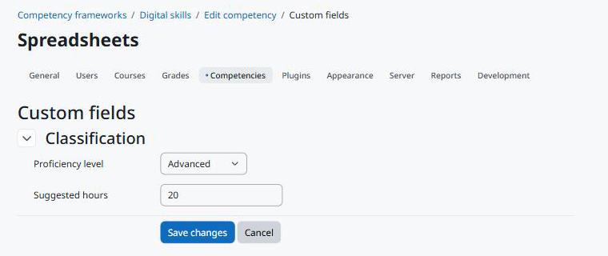

Uso
===

Editando os valores
-------------------

Os valores e um botão *Edit custom fields* aparecem no topo destas páginas, para quem pode editar os valores:

* a página que edita uma competência (*Editar* no menu da competência, dentro do quadro): valores da competência;
* a página que edita um quadro e a página do quadro com a árvore de competências: valores do quadro.

O botão abre a página comum de edição da Moodle Fields Suite. Ao salvar, você volta ao quadro.

   Editando os valores de uma competência.

Quem não pode editar vê só os valores visíveis para si; quando não há nenhum, nada aparece.

Web service
-----------

``local_fieldssuite_get_values`` com ``component=tool_competencycustomfields``, ``area=competency`` (ou ``framework``) e os ``instanceids`` devolve, para cada competência ou quadro que o usuário pode ver, os campos que ele pode ver.

.. code-block:: bash

   curl "https://moodle.exemplo/webservice/rest/server.php?wstoken=TOKEN&moodlewsrestformat=json&wsfunction=local_fieldssuite_get_values&component=tool_competencycustomfields&area=competency&instanceids[0]=12"

Excluindo
---------

Excluir uma competência exclui os valores dela; excluir um quadro exclui os valores dele e das suas competências. Os campos continuam.
